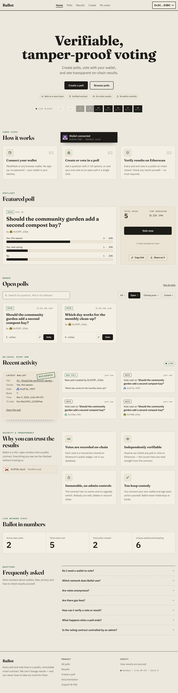
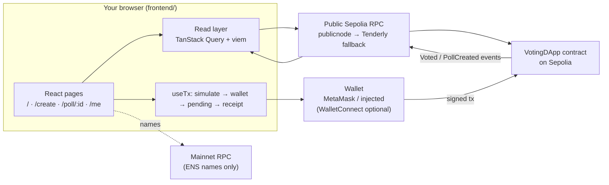

# Ballot — on-chain polls with a receipt you can verify

Ballot is a voting app on Ethereum's **Sepolia test network**. Anyone can create a poll, any wallet can vote **once** before
the deadline, and anyone — even without a wallet — can watch the results live. After you vote you get a **ballot receipt**:
the transaction hash, block number, time and network, with a link to check it yourself on Etherscan. The receipt is rebuilt
from the blockchain, not from this website, so it is proof rather than decoration.

| | |
|---|---|
| **Contract (Sepolia)** | [`0x5dD2Dd61c5615E027b1E3FA5c915Aef473c0D844`](https://sepolia.etherscan.io/address/0x5dD2Dd61c5615E027b1E3FA5c915Aef473c0D844) |
| **Verified source** | [Sourcify (exact match)](https://sourcify.dev/server/repo-ui/11155111/0x5dD2Dd61c5615E027b1E3FA5c915Aef473c0D844) |
| **Deployed in block** | 12077541 |
| **Live site** | https://ballot-omega.vercel.app |



---

## How it works, in plain English

1. **The rules live in a smart contract** (`contracts/contracts/VotingDApp.sol`). It's a small program stored on the
   blockchain. Once deployed, nobody — including us — can change it. It enforces: 2–10 options, a deadline between
   5 minutes and 30 days away, one vote per wallet, no voting after the deadline.
2. **Reading is free.** The website asks a public Sepolia server ("RPC endpoint") for the polls and counts. That's why it
   works without a wallet.
3. **Writing needs a wallet.** Creating a poll or voting is a *transaction*: your wallet (e.g. MetaMask) signs it and pays a
   tiny network fee ("gas") in test ETH, which is free from a faucet.
4. **Before your wallet even opens, the app rehearses the transaction** ("simulation"). If the contract would refuse it —
   say you already voted — you see a plain sentence instead of paying for a failed transaction.
5. **Every vote emits a public log entry** (`Voted` event). The app listens for these to update results live, and uses
   your own entry to print your ballot receipt.
6. **Polls open and close by blockchain time**, not your computer's clock, so a wrong clock can't show a closed poll as open.



## What's in this repo

| Path | What it does |
|---|---|
| `contracts/contracts/VotingDApp.sol` | The smart contract: polls, votes, cancel, paginated reads. Commented line by line. |
| `contracts/test/VotingDApp.ts` | 45 tests, one per rule (limits, deadlines, double votes, cancel, pagination, ETH rejection). |
| `contracts/scripts/` | `new-wallet` (makes a throwaway deployer), `balance`, `deploy`, `verify`, `smoke` (create + vote on a live chain). |
| `frontend/src/config/` | Which chain, which RPCs, which wallets; checks env vars at startup. |
| `frontend/src/contract/` | `deployments.json` (address + deploy block per chain) and the ABI — written by the deploy script. |
| `frontend/src/hooks/useTx.ts` | The single path every write goes through (simulate, wallet, pending saved across refresh, decoded errors). |
| `frontend/src/lib/errors.ts` | Turns contract errors like `AlreadyVoted` into sentences like "This wallet has already voted in this poll." |
| `frontend/src/pages/` | Homepage (hero → how it works → featured poll → browse with search/filters → recent activity → trust & security → stats → FAQ), all polls (`/polls`), results (`/results`: final + live outcomes), create form, poll page, my votes. |
| `frontend/e2e/` | 46 browser tests against a local blockchain, with a scriptable fake wallet. |
| `docs/BUILD_LOG.md` | Every phase's status report and every decision made along the way. |
| `docs/screenshots/` | The finished app, light and dark. |

## Run it on your computer

You need **Node.js 22** (`nvm use` reads `.nvmrc`). No accounts or keys are needed for local development.

```bash
cd contracts && npm install
```

```bash
cd frontend && npm install
```

**Option A — use the real Sepolia contract (read-only until you connect a wallet on Sepolia):**

```bash
cd frontend && npm run dev
```

Open http://localhost:5173.

**Option B — a private local blockchain (instant, free, resets when stopped).** Three terminals:

```bash
cd contracts && npm run node
```

```bash
cd contracts && npm run deploy:local
```

```bash
cd frontend && VITE_CHAIN=localhost npm run dev
```

To vote locally, add network `http://127.0.0.1:8545` (chain id 31337) to MetaMask and import one of the test accounts that
`npm run node` prints. Those keys are public test keys — never use them on a real network.

## Tests

| Suite | Command | Count |
|---|---|---|
| Contract | `cd contracts && npm test` | 45 |
| Contract gas report | `cd contracts && npm run test:gas` | — |
| Frontend unit | `cd frontend && npm test` | 35 |
| End-to-end (starts its own chain + server) | `cd frontend && npm run e2e` | 46 |
| Type check / build | `cd frontend && npm run typecheck && npm run build` | — |

The end-to-end tests cover: creating a poll, voting, double votes, wrong network, rejecting in the wallet, not enough ETH,
refreshing while a vote is pending, a poll expiring while you watch it (time travel), zero votes, ties, winners, cancelled
polls, not-found pages, browsing with no wallet, switching and disconnecting accounts, `/me`, the share link, and the
homepage (hero centred in the viewport, open-poll cards and ranking, activity sentences, live stats).

## Deploy the contract (already done — only if you want your own copy)

```bash
cd contracts && npm run wallet:new
```

This creates a **throwaway Sepolia-only** wallet, writes its key straight into `contracts/.env` (never committed) and prints
only the address. Send it ~0.02 Sepolia ETH from a faucet, then:

```bash
cd contracts && npm run balance:sepolia
```

```bash
cd contracts && npm run deploy:sepolia
```

```bash
cd contracts && npm run smoke:sepolia
```

The deploy verifies the source on Sourcify automatically (Etherscan too, if you put an `ETHERSCAN_API_KEY` in
`contracts/.env`) and updates `frontend/src/contract/deployments.json`.

## Deploy the website (Vercel)

The site is deployed at https://ballot-omega.vercel.app (Vercel project `ballot`). To redeploy after changes:

```bash
cd frontend && npx vercel@65.12.1 deploy --prod
```

The first run asks you to log in and link a project. Accept the detected settings (Vite, output `dist`). `vercel.json`
already contains the rewrite that makes deep links like `/poll/3` work on refresh.

**Environment variables in Vercel: none are required.** All are optional (see `frontend/.env.example`):

| Variable | When to set it |
|---|---|
| `VITE_SEPOLIA_RPC_URL` | You want your own RPC instead of the free public ones. **Anything in a `VITE_` variable is public** — if it contains an API key, restrict that key to your domain in the provider's dashboard. |
| `VITE_WALLETCONNECT_PROJECT_ID` | You want QR-code / mobile wallets (free id from cloud.reown.com). Without it, browser wallets and MetaMask's in-app browser still work. |
| `VITE_MAINNET_RPC_URL` | Your own mainnet RPC for ENS name lookups. |
| `VITE_CHAIN` | Leave unset (Sepolia). `localhost` is for development. |
| `VITE_SOURCE_URL` | Your GitHub repo, shown as "Source code" in the footer. Unset → the verified contract source on Sourcify. |
| `VITE_DOCS_URL` | A documentation site for the footer. Unset → the homepage "How it works" section. |
| `VITE_SUPPORT_URL` | Support link (`https://…` or `mailto:…`). Unset → the FAQ. |

## Design decisions

- **"Civic paper", not crypto neon.** Warm paper, black ink, one ballot-green accent saved for "stamped" moments (the Open
  label, the Recorded stamp). Fraunces for titles, IBM Plex Sans for text, IBM Plex Mono for hashes and numbers. Results are
  thick ink bars with the count and percentage written out, so colour is never the only signal. Two variations were built
  and compared; the reasoning is in `docs/BUILD_LOG.md` (Phase 5).
- **Proper dark mode and reduced motion.** Every text colour passes WCAG AA in both themes (lowest 5.6:1); the stamp animation
  is skipped if your system asks for less motion.
- **Limits are counted in bytes, like the contract.** A Tamil letter or emoji uses 3–4 bytes, so the form shows byte counters.
- **One write path.** Every transaction is simulated first, so contract errors appear as sentences *before* the wallet opens.
  Rejecting in your wallet shows a calm "Vote not sent.", not a red error.
- **Pending transactions survive a refresh** (the hash is kept in your browser), and the receipt is rebuilt from the
  blockchain, so it survives cleared storage and other devices.
- **Live but resilient.** The app listens for vote events; if that fails, it quietly falls back to checking every ~12 seconds.
- **Zero-signup defaults.** Free public RPCs with a fallback, Sourcify verification without an API key, browser wallets
  without a WalletConnect id.
- **Small contract, no libraries.** No OpenZeppelin, no owner, no upgrades, no payable functions, no external calls — so no
  admin can tamper with polls and there is no reentrancy surface.

## Known limitations (accepted, not bugs)

- **One wallet = one vote, not one person = one vote.** Anyone can make many wallets (a "Sybil" attack). Fine for a demo
  or a group that trusts each other; not for elections.
- **Votes are public.** Anyone can see which address chose what — that's what makes them verifiable.
- **Anyone can create polls.** Spam is limited only by gas cost.
- **Block timestamps can drift a few seconds.** Fine for polls measured in minutes or days.
- **The contract can't be changed.** Fixing a bug means deploying a new contract at a new address.
- **Creators can cancel only before the first vote**, so nobody can erase a poll that's going against them.
- **Receipts look up your `Voted` log from the deploy block onwards.** Public RPCs limit how many blocks one query may span;
  years from now the lookup may need an indexer. Your vote itself is always counted and visible.
- **Sepolia gas numbers differ from local ones.** The deploy used ~8.8M gas on Sepolia versus ~1.3M locally (Sepolia's newer
  fork prices new contract storage far higher). At test-network prices it cost a fraction of a cent of test ETH.
- **`npm audit` reports advisories in dependencies we don't control:** 30 in `frontend/` (2 low, 12 moderate, 16 high) — all
  inside the wallet-connector SDKs pulled in by RainbowKit/wagmi (`ws`, `zod`, `decode-uri-component`, `uuid`,
  `deepmerge`); 12 high in `contracts/`, all the same `zod` advisory inside Hardhat's dev tooling, which never ships to users.
  `npm audit fix --force` would install breaking versions, so they're left until upstream releases fixes.
- **wagmi 2, not 3.** RainbowKit (latest 2.2.11) still requires wagmi 2.

## Safety notes

- `.env` files are git-ignored from the first commit. The deployer key is generated by a script, written only to
  `contracts/.env`, and never printed. It's a **test-network-only** wallet: never send real ETH to it.
- Poll text is untrusted: it's always rendered as plain text (no HTML, no auto-linked URLs).
